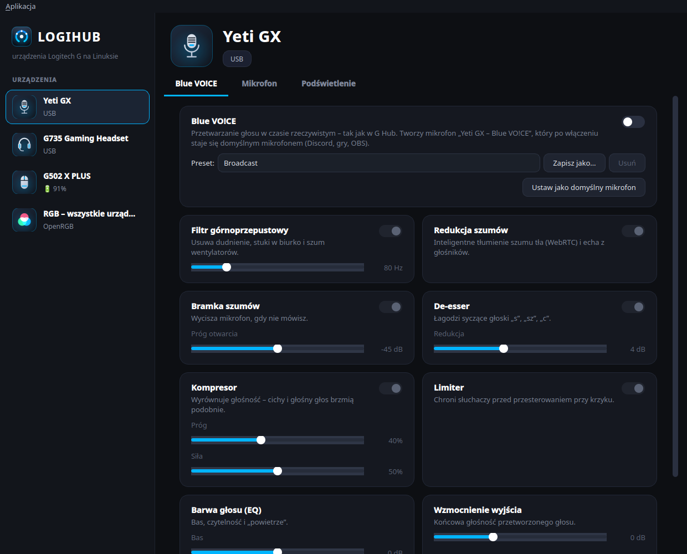
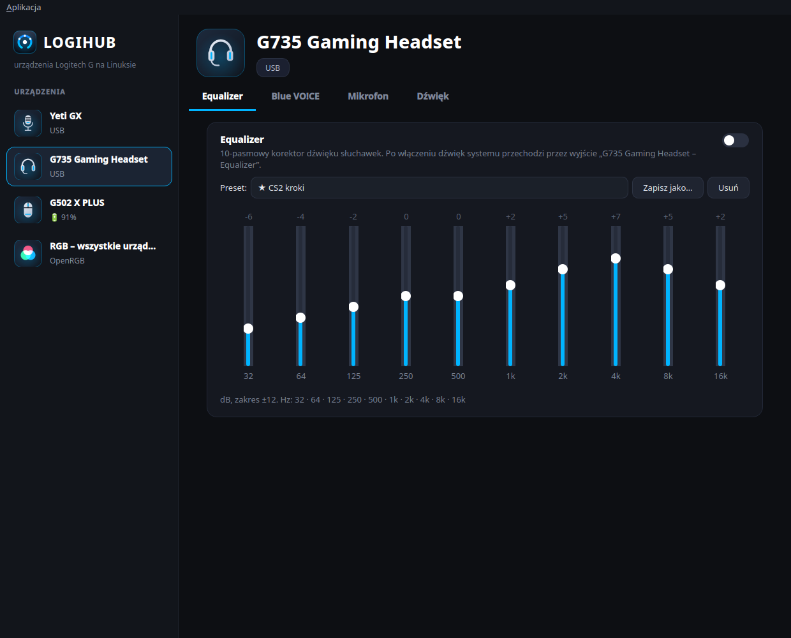
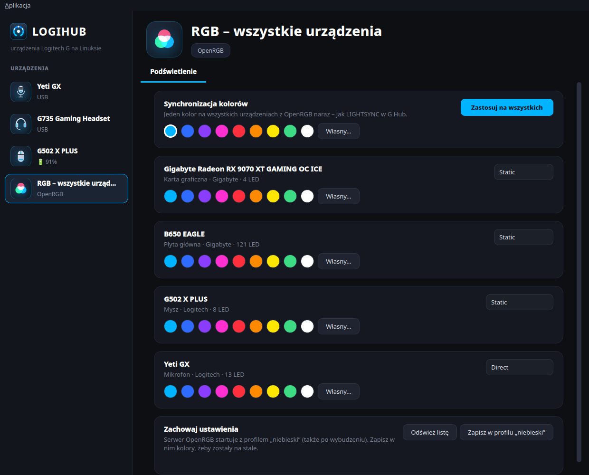

# LogiHub

**Linuksowy odpowiednik Logitech G Hub** – jedna aplikacja do myszy, słuchawek, mikrofonu i podświetlenia.
Napisana w C++/Qt6, bez Pythona, bez Electrona i bez roota. Z myszami i mikrofonami Logitecha rozmawia
bezpośrednio protokołem **HID++ 2.0** przez `/dev/hidraw`, dźwięk obsługuje przez **PipeWire**,
a RGB innych firm przez **OpenRGB**.

> Projekt niezależny, niezwiązany z firmą Logitech. „Logitech”, „G Hub”, „LIGHTSPEED” i „Blue VO!CE”
> to znaki towarowe Logitech International. Ikony i rysunek myszy są własne.


## Funkcje

### Myszy Logitech G (testowane: G502 X PLUS przez odbiornik LIGHTSPEED)
- **Przyciski na rysunku myszy jak w G Hub** – kliknij przycisk, wybierz funkcję: kliknięcia,
  DPI w górę/dół/cykl/Shift, profile, multimedia, dowolny klawisz lub skrót. Warstwa **G-Shift**.
- **Czułość** – 5 etapów DPI na graficznym pasku, etap domyślny, DPI Shift (snajperski),
  częstotliwość raportowania 125–1000 Hz.
- **Profile w pamięci myszy** (jak „pamięć wbudowana” w G Hub) – zapis do myszy, działa bez aplikacji
  i na innych komputerach. Nazwy profili, aktywacja, **kopia zapasowa przed każdym zapisem**.
- Tryb „z aplikacji” – DPI, polling i RGB na żywo.
- Podświetlenie: stały kolor, oddychanie, cykl kolorów; bateria i stan ładowania.


### Mikrofony i słuchawki – dowolnej firmy (USB i Bluetooth)
- **Blue VO!CE** – przetwarzanie głosu w czasie rzeczywistym: filtr górnoprzepustowy, redukcja szumów
  i echa (WebRTC), bramka szumów, de-esser, kompresor, limiter, barwa głosu, presety (Broadcast,
  Podcast, Gaming…) i **własne presety**. Tworzy wirtualny mikrofon dla Discorda, gier i OBS.
- **Equalizer 10-pasmowy** z presetami (FPS, Muzyka, Filmy, Bas…) i własnymi presetami.
- **Sidetone / odsłuch** – słyszysz własny głos w słuchawkach.
- Głośność i wyciszenie, sprzętowe wzmocnienie mikrofonu (ALSA).
- Zmiany suwaków działają na żywo, bez przerywania dźwięku.




### Mikrofon Yeti GX
Podświetlenie (2 strefy), jasność, Blue VO!CE, wzmocnienie, odsłuch.

### RGB wszystkich urządzeń (przez OpenRGB)
Jeśli działa serwer OpenRGB (`openrgb --server`), LogiHub pokazuje wszystkie jego urządzenia – karty
graficzne, płyty główne, RAM, klawiatury… – z wyborem trybu i koloru, **synchronizacją jednego koloru
na wszystkim** (jak LIGHTSYNC) i zapisem w profilu startowym OpenRGB.



### Wygoda
- Ikona w zasobniku – zamknięcie okna chowa aplikację, efekty audio działają dalej.
- Autostart (menu *Aplikacja*), jedna instancja (ponowne uruchomienie pokazuje okno).
- Lekka: w tle ~0% CPU i ~20 MB RAM; wykrywanie podłączenia przez inotify zamiast odpytywania.

## Czy działa na GNOME?

**Tak.** LogiHub nie zależy od KDE – używa Qt6 z własnym ciemnym motywem, więc wygląda tak samo
na GNOME, KDE i innych środowiskach (Wayland i X11). Na GNOME warto wiedzieć:

| | KDE Plasma | GNOME |
|---|---|---|
| Okno, wszystkie funkcje | ✅ | ✅ |
| PipeWire (Blue VO!CE, EQ, sidetone) | ✅ | ✅ (Fedora, Ubuntu 22.10+ i nowsze mają PipeWire domyślnie) |
| Ikona w zasobniku | ✅ | ⚠️ GNOME domyślnie nie ma zasobnika – zainstaluj rozszerzenie **AppIndicator and KStatusNotifierItem Support** (w Ubuntu jest wbudowane). Bez niego zamknięcie okna kończy LogiHub, więc efekty audio działają tylko przy otwartym oknie. |
| Autostart | ✅ | ✅ (`~/.config/autostart`) |
| Qt6 | zwykle zainstalowane | trzeba doinstalować biblioteki Qt6 (patrz niżej) |

## Instalacja

```bash
git clone https://github.com/Sprytnyhuj/logihub.git
cd logihub
./install.sh              # buduje i instaluje do ~/.local/bin, dodaje skrót w menu
./install.sh --autostart  # + start przy logowaniu, schowany w zasobniku
```

Potrzebne pakiety do zbudowania:

| System | Polecenie |
|---|---|
| Fedora | `sudo dnf install cmake ninja-build gcc-c++ qt6-qtbase-devel ladspa-caps-plugins` |
| Ubuntu / Debian | `sudo apt install cmake ninja-build g++ qt6-base-dev caps` |
| Arch | `sudo pacman -S cmake ninja qt6-base caps` |
| Bazzite / Silverblue | budowanie w distroboxie: `distrobox create -n builder -i fedora:44`, w nim pakiety jak dla Fedory |

**Dostęp do urządzeń bez roota.** Jeśli `install.sh` napisze, że nie ma dostępu do `/dev/hidraw*`,
dodaj jednorazowo regułę udev:

```bash
sudo cp udev/70-logihub.rules /etc/udev/rules.d/
sudo udevadm control --reload && sudo udevadm trigger
```

## Bezpieczeństwo zapisu do myszy

- Zmieniane są tylko znane pola profilu, pozostałe bajty zostają bez zmian, suma CRC jest przeliczana.
- Przed każdym zapisem kopia sektora trafia do `~/.local/share/logihub/backups/`.
- Po zapisie profil jest odczytywany z powrotem i porównywany.
- „Przywróć kopię zapasową…” wgrywa dowolną kopię z powrotem.

## Ograniczenia

- **Słuchawki Logitech G735**: sprzętowe RGB, sidetone i wbudowany EQ używają nieopisanego protokołu
  (raporty 0xF0–0xF3), więc EQ, Blue VO!CE i sidetone działają tu programowo.
- **Klawiatury innych firm** z własnym protokołem (np. GSKY) – tylko gdy obsługuje je OpenRGB.
- Rysunek przycisków jest dla G502 X / G502 X PLUS; inne myszy HID++ mają listę przycisków.
- Inne myszy i klawiatury Logitecha z tymi samymi funkcjami HID++ (0x1004, 0x2201, 0x8060, 0x8071,
  0x8100) powinny działać, ale nie były testowane.

## Dla programistów

```bash
QT_QPA_PLATFORM=offscreen ./build/test_hidpp        # testy jednostkowe (bez sprzętu)
./build/hwcheck /dev/hidrawN 01                      # odczyt profili myszy
./build/hwcheck /dev/hidrawN 01 --rewrite-same       # test zapisu (zapis tego samego, bez zmian)
./build/hwcheck --openrgb                            # lista urządzeń OpenRGB
LOGIHUB_AUDIO_ALL=1 logihub                          # pokaż też karty wbudowane / HDMI
```

Struktura: `hidpp` (protokół), `onboard` (profile w pamięci), `dsp` (łańcuchy PipeWire),
`openrgb` (klient SDK), `devicepage` / `mousediagram` / `audiowidgets` / `rgbpanel` (interfejs).
