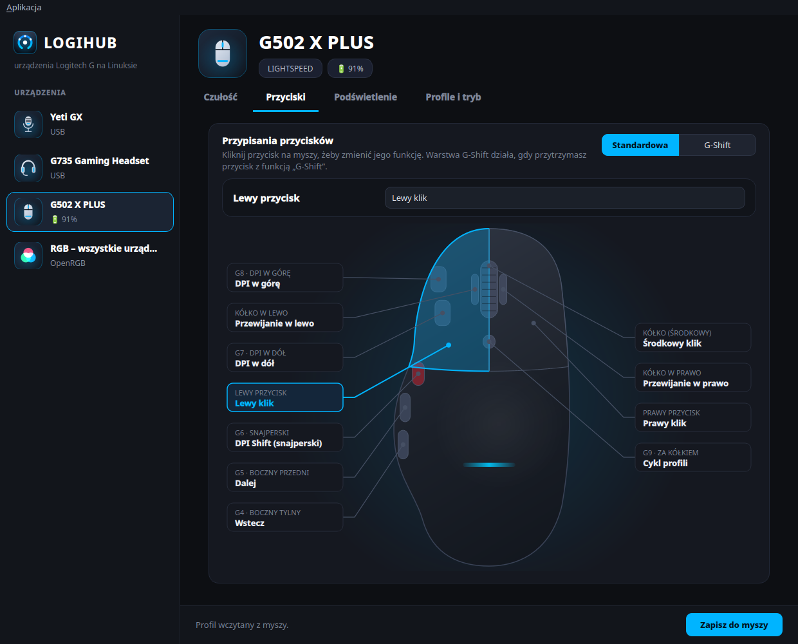
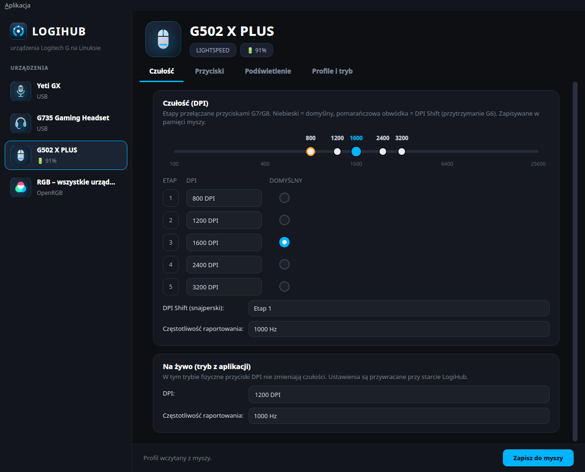

# LogiHub

**A Logitech G Hub alternative for Linux** – one app for your mouse, headset, microphone and RGB lighting.
Written in C++/Qt6: no Python, no Electron, no root. It talks to Logitech mice and mics directly over
**HID++ 2.0** (`/dev/hidraw`), handles audio through **PipeWire**, and controls other brands' RGB through
**OpenRGB**.

🇵🇱 [Polska wersja opisu](README.pl.md) · The UI is currently in Polish.

> Independent project, not affiliated with Logitech. "Logitech", "G Hub", "LIGHTSPEED" and "Blue VO!CE"
> are trademarks of Logitech International. Icons and the mouse drawing are original artwork.



## Features

### Logitech G mice (tested: G502 X PLUS over a LIGHTSPEED receiver)
- **Button assignment on a picture of the mouse, like G Hub** – click a button, pick an action: clicks,
  DPI up/down/cycle/shift, profiles, media keys, any key or shortcut. **G-Shift** layer included.
- **Sensitivity** – 5 DPI stages on a visual track, default stage, DPI Shift (sniper), polling rate 125–1000 Hz.
- **Onboard memory profiles** (G Hub's "onboard memory mode") – written to the mouse, so they work without
  the app and on other computers. Profile names, activation, **automatic backup before every write**.
- "Software" mode – live DPI, polling rate and RGB.
- Lighting (static, breathing, colour cycle), battery level and charging state.



### Microphones and headsets – any brand (USB and Bluetooth)
- **Voice FX** – real-time voice processing in the style of G Hub's Blue VO!CE: high-pass filter,
  **AI noise reduction (RNNoise)** or WebRTC noise & echo reduction, noise gate, **dynamic de-esser**,
  compressor, limiter, voice EQ, presets (Broadcast, Podcast, Gaming…) and **your own presets**.
  Creates a virtual microphone for Discord, games and OBS.
  *This is not Logitech's Blue VO!CE* – that is proprietary and Windows/macOS only. LogiHub ships its own
  effects (a small LADSPA plugin, tested on test signals) that cover the same set of modules.
- **10-band equalizer** with presets (FPS, Music, Movies, Bass…) and custom presets.
- **Sidetone / mic monitoring** – hear your own voice in the headset.
- Volume and mute, hardware mic gain (ALSA).
- All sliders apply live, without interrupting audio.


### Yeti GX microphone
Lighting (2 zones), brightness, Voice FX, gain, monitoring.

### RGB for everything (via OpenRGB)
If an OpenRGB server is running (`openrgb --server`), LogiHub lists all its devices – GPUs, motherboards,
RAM, keyboards… – with mode and colour selection, **one-click colour sync across all devices**
(like LIGHTSYNC), and saving to OpenRGB's startup profile.


### Comfort
- Tray icon – closing the window keeps LogiHub (and audio effects) running in the background.
- Autostart, single instance, **built-in updates**.
- Lightweight: ~0% CPU and ~20 MB RAM in the background; device hot-plug via inotify instead of polling.

## Installation

### Option 1 – ready-made package (recommended, works on any distro, also GNOME without Qt)

Download `logihub-<version>-x86_64.tar.gz` from
[**Releases**](https://github.com/Sprytnyhuj/logihub/releases/latest), then:

```bash
tar -xzf logihub-*-x86_64.tar.gz
cd logihub
./install.sh              # installs to ~/.local, adds a menu entry – no root needed
./install.sh --autostart  # + start on login (in the tray)
```

The package bundles Qt6, so nothing else is required. Requires glibc 2.38+ (Fedora 39+, Ubuntu 24.04+,
Debian 13, Arch, Bazzite, Bluefin, Silverblue).

### Option 2 – build from source

```bash
git clone https://github.com/Sprytnyhuj/logihub.git
cd logihub
./install.sh
```

| Distro | Build dependencies |
|---|---|
| Fedora | `sudo dnf install cmake ninja-build gcc-c++ qt6-qtbase-devel ladspa-devel rnnoise-devel` |
| Ubuntu / Debian | `sudo apt install cmake ninja-build g++ qt6-base-dev ladspa-sdk librnnoise-dev` |
| Arch | `sudo pacman -S cmake ninja qt6-base ladspa rnnoise` |
| Bazzite / Silverblue / Bluefin | use option 1, or build inside a distrobox (`distrobox create -n builder -i fedora:42`) |

### Device access without root

If the installer says it cannot access `/dev/hidraw*`, add the udev rule once:

```bash
sudo cp udev/70-logihub.rules /etc/udev/rules.d/
sudo udevadm control --reload && sudo udevadm trigger
```

Voice FX needs no extra system packages – its effects (and RNNoise) ship inside the package. When building
from source, `ladspa.h` is required for the effects and `rnnoise` is optional (without it noise reduction
uses WebRTC).

## Updating

- **Package install:** LogiHub checks GitHub once a day. When a new version is out you get a tray
  notification – *Aplikacja → Zainstaluj aktualizację* downloads it, installs it and restarts the app.
  You can also check manually: *Aplikacja → Sprawdź aktualizacje*, or just run `./install.sh` from a newer package.
- **Source install:** `git pull && ./install.sh`
- Uninstall (package): `./install.sh --uninstall` from the package folder.

## Does it work on GNOME?

**Yes.** LogiHub doesn't depend on KDE – it's Qt6 with its own dark theme, so it looks the same on GNOME,
KDE and others (Wayland and X11).

| | KDE Plasma | GNOME |
|---|---|---|
| Window, all features | ✅ | ✅ |
| PipeWire (Voice FX, EQ, sidetone) | ✅ | ✅ (default on Fedora, Ubuntu 22.10+) |
| Tray icon | ✅ | ⚠️ GNOME has no tray by default – install the **AppIndicator and KStatusNotifierItem Support** extension (built into Ubuntu). Without it, closing the window quits LogiHub, so audio effects only run while the window is open. |
| Autostart | ✅ | ✅ |

## Safety of writes to the mouse

- Only known profile fields are changed; all other bytes are kept as-is and the CRC is recalculated.
- Before every write the sector is backed up to `~/.local/share/logihub/backups/`.
- After writing, the profile is read back and compared.
- "Przywróć kopię zapasową…" (restore backup) writes any backup back.

## Limitations

- **Logitech G735 headset:** hardware RGB, sidetone and onboard EQ use an undocumented protocol
  (reports 0xF0–0xF3), so EQ, Voice FX and sidetone are done in software.
- **Other brands' keyboards** with proprietary protocols – only if OpenRGB supports them.
- The button picture is for the G502 X / G502 X PLUS; other HID++ mice get a button list.
- Other Logitech mice with the same HID++ features (0x1004, 0x2201, 0x8060, 0x8071, 0x8100) should work
  but are untested. Reports and pull requests are welcome!

## For developers

```bash
QT_QPA_PLATFORM=offscreen ./build/test_hidpp        # unit tests (no hardware needed)
./build/hwcheck /dev/hidrawN 01                      # read mouse profiles
./build/hwcheck /dev/hidrawN 01 --rewrite-same       # write test (writes identical data)
./build/hwcheck --openrgb                            # list OpenRGB devices
logihub --check-update                               # check GitHub for a new release
LOGIHUB_AUDIO_ALL=1 logihub                          # also show built-in / HDMI audio devices
packaging/build-release.sh 0.2.0                     # build the portable package (podman, fedora:42)
```

**Releasing an update:** bump `VERSION` in `CMakeLists.txt`, run `packaging/build-release.sh <version>`,
then `gh release create v<version> dist/logihub-<version>-x86_64.tar.gz` – installed copies will offer it
automatically.

Layout: `hidpp` (protocol), `onboard` (onboard profiles), `dsp` (PipeWire chains), `openrgb` (SDK client),
`updater` (GitHub releases), `devicepage` / `mousediagram` / `audiowidgets` / `rgbpanel` (UI).
